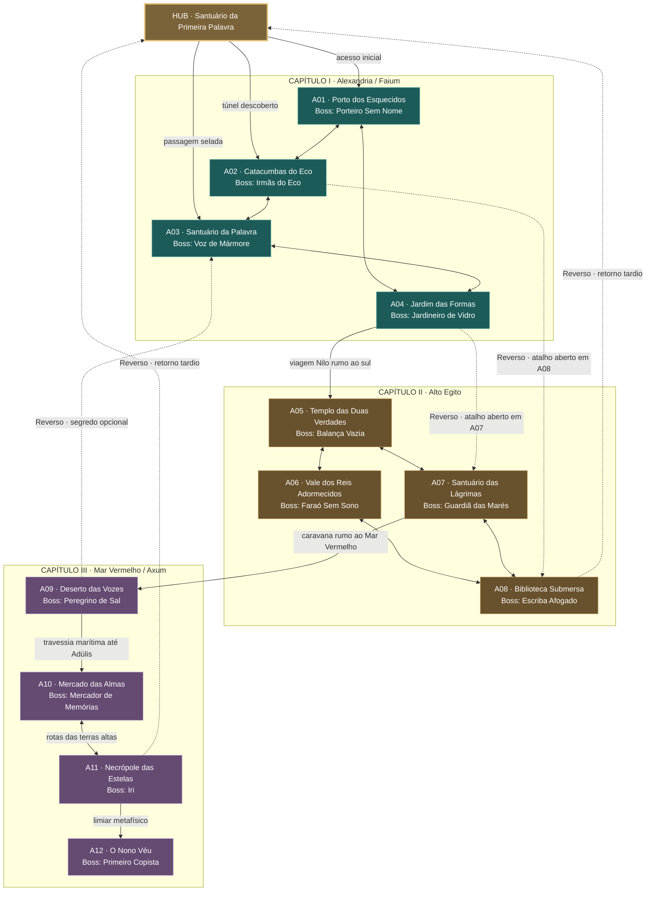
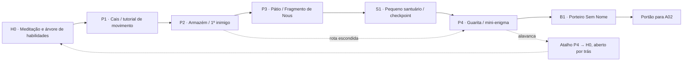
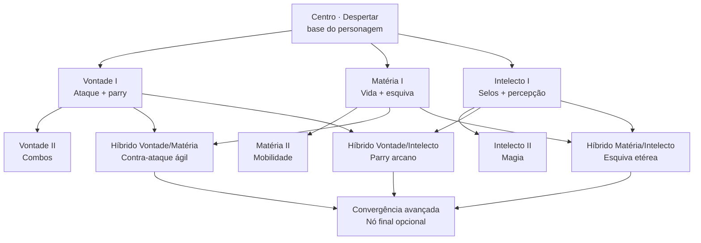
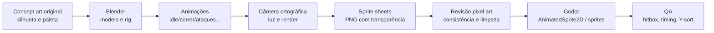

# O NONO VÉU

> **Game Design Document (GDD) + Bíblia Narrativa + Mapa-Mestre + Arsenal + Pipeline Blender/Godot + Briefing para o Codex**  
> **Versão:** 1.1 · **Atualizado em:** 24/10/2026 · **Idioma:** Português (Brasil)  
> **Status:** Documento de pré-produção. Não representa um jogo já implementado.

---

## 0. LEIA ISTO PRIMEIRO, CODEX

Você é o agente técnico de um jogo independente chamado **O Nono Véu**. Leia este documento inteiro **antes de criar código, cenas ou assets**. Ele estabelece a visão, as decisões já tomadas, a história, o mundo e um plano de execução.

**Não tente implementar as 12 áreas ou todas as armas de uma vez.** A primeira entrega solicitada é uma **vertical slice jogável** do *Porto dos Esquecidos*: personagem isométrico, movimentação, câmera, colisões, ataque, esquiva, parry, um inimigo, uma passagem/atalho, um santuário de salvamento, um Fragmento de Nous coletável, um nó de habilidade adquirível, interface mínima e um chefe protótipo. Utilizar artes temporárias **originais** até a direção visual estar consolidada.

**Instruções para trabalhar no projeto:**

1. Inspecione a pasta do projeto e identifique as versões instaladas do **Godot e Blender**, seus executáveis e os recursos já existentes antes de escolher APIs ou editar arquivos.
2. Prefira **Godot 4.x + GDScript** para reduzir a complexidade inicial. C# **não é um requisito**. Não migre para outra engine sem necessidade e aprovação do usuário.
3. Respeite a distinção entre **[DECIDIDO]**, **[PROPOSTA]** e **[EM ABERTO]** que aparece neste GDD.
4. Planeje e implemente em incrementos pequenos; preserve projeto executável depois de cada etapa; valide cenas, scripts e dependências. Não afirme que foi testado sem executar os testes.
5. Arte, personagens, mapas, ícones, músicas e diálogos devem ser **originais**. Obras de referência não são autorização para copiar seus assets, identidade visual ou personagens.
6. Não converta a árvore de habilidades em uma reprodução religiosa literal da Cabala. Seu uso é de **inspiração estética/estrutural**, não de correspondência obrigatória com sefirot, fases ou poderes.
7. Mantenha o mapa **interconectado** e as distâncias entre Egito e Etiópia plausíveis na camada física. Os atalhos inter-regionais excepcionais pertencem ao **Reverso** e só surgem depois de desbloqueados.
8. Registre questões técnicas, suposições, implementações e pendências no repositório (por exemplo, `docs/DECISOES.md` e `docs/PROGRESSO.md`) quando o projeto começar.
9. Antes de iniciar implementação em larga escala, produza uma lista curta de decisões técnicas e o backlog da vertical slice. Só então implemente o menor trecho jogável.
10. **[DECIDIDO]** O arsenal possui três classes: **Leves, Espadas, Pesadas**, cada uma com **várias armas distintas** e seus próprios poderes e estilos. Implemente primeiro a infraestrutura modular e apenas duas armas de demonstração, não as 12 de uma vez.
11. O **Blender está instalado** e poderá ser automatizado por scripts Python/CLI para modelos, animações e renderizações; usar o **Godot** como engine e o **Codex** para orquestração. Integrações MCP são opcionais, não pressupostas. **Nunca declarar instalação, integração ou testes concluídos sem verificar**.
12. Referências visuais e imagens conceituais **não** são modelos prontos, sprite sheets validados ou texturas diretamente utilizáveis. Aplicar controles de qualidade e manter o projeto jogável com placeholders durante a produção da arte.

### Legenda de decisões

- **[DECIDIDO]**: o usuário aprovou explicitamente ou confirmou ao longo da conversa. Preservar.
- **[PROPOSTA]**: esboço criado durante a discussão e acolhido como direção; nomes, quantidades finas e detalhes podem ser refinados.
- **[EM ABERTO]**: requer definição em playtests ou validação posterior; não trate como fato fechado.

---

## 1. VISÃO DO JOGO

| Campo | Direção |
|---|---|
| **Título de trabalho** | **O Nono Véu** [PROPOSTA — título ainda pode mudar] |
| **Gênero** | **RPG de ação + Metroidvania** [DECIDIDO] |
| **Câmera** | **Isométrica**, com movimentação em múltiplas direções [DECIDIDO] |
| **Visual** | Pixel art sombria, mística, decadente, detalhada e original [DECIDIDO] |
| **Ambientação** | Egito e região histórica do reino de Axum, hoje sobretudo Etiópia e Eritreia [DECIDIDO quanto à inspiração geográfica] |
| **Base espiritual/narrativa** | Hermetismo e a figura mítica de Hermes Trismegisto [DECIDIDO] |
| **Herói** | Um **discípulo de Hermes Trismegisto**; nome de trabalho **Senu** [DECIDIDO quanto à condição de discípulo; nome PROPOSTO] |
| **Organização** | **3 capítulos, com 4 áreas cada, totalizando 12 áreas e 12 chefes principais**, um ao final de cada área [DECIDIDO] |
| **Mundo** | Regiões organicamente **interconectadas**, com retorno a um hub central, atalhos e backtracking significativo [DECIDIDO] |
| **Progressão** | Árvore de habilidades inspirada visualmente na Árvore da Vida, com **pontos coletados pelos mapas** [DECIDIDO] |
| **Tecnologia** | Godot 4.x; GDScript recomendado, mas sem restrição obrigatória a C# [DECIDIDO sobre liberdade de linguagem; engine escolhida] |
| **Plataforma inicial** | PC Windows (`.exe`) [DECIDIDO] |
| **Armas** | Três classes **Leves / Espadas / Pesadas**, várias armas e poderes em cada classe [DECIDIDO]; nomes e quantidades [PROPOSTA] |
| **Produção visual** | Blender para modelos/animações, Godot para jogo, Codex como agente de desenvolvimento [DECIDIDO quanto ao uso das ferramentas]; 3D pré-renderizado em pixel art [PROPOSTA recomendada] |
| **Escopo da primeira entrega** | Vertical slice, não jogo completo [PROPOSTA de produção] |

### 1.1 Promessa ao jogador

Explorar um Egito e um mundo axumita de fantasia sombria em uma jornada hermética; descobrir como regiões aparentemente separadas se conectam; enfrentar inimigos e chefes de forte identidade; ganhar poderes ao explorar e interpretar mistérios; retornar a lugares antigos com novas possibilidades; decidir o destino da individualidade humana.

### 1.2 Pilares de design

1. **O mundo é o quebra-cabeça** — a satisfação de descobrir uma conexão ou abrir um atalho deve ser comparável à de vencer um chefe.
2. **Combate preciso e legível** — movimentos comprometidos, boas janelas de resposta, telegráficos claros e confrontos justos.
3. **Misticismo com substância** — símbolos, discussões e enigmas dialogam com os temas da narrativa, sem serem apenas decoração.
4. **Exploração recompensa curiosidade** — atalhos, Fragmentos de Nous, **armas e poderes únicos**, relíquias, encontros, conhecimento e pistas sobre os finais.
5. **Mistério ambiental** — informações parciais e contraditórias, ruínas que contam histórias e personagens cujas intenções nem sempre são transparentes.
6. **Identidade cultural respeitosa** — pesquisa histórica e separação nítida entre tradições reais e elementos fictícios.

### 1.3 Referências criativas — o que aproveitar, sem copiar

| Jogo | Inspiração desejada | O que não reproduzir |
|---|---|---|
| **Blasphemous** | Pixel art densa; peso visual e simbólico; brutalidade; chefes marcantes; arquitetura monumental | Personagens, iconografia específica, mapas, sprites, animações ou cenas da obra |
| **Hollow Knight** | Mundo interconectado; atmosfera solitária e melancólica; exploração não linear; narrativa ambiental; chefes; relíquias equipáveis | Hallownest, amuletos com a mesma arte/descrição, inimigos e movimentos diretamente copiados |
| **Dark Souls 1** | A sensação de reencontrar o hub após um caminho longo; escadas, portões e elevadores que mudam a percepção espacial; checkpoints significativos | Layout de Firelink Shrine, rotas equivalentes cena a cena ou mecânicas idênticas desnecessárias |
| **Death's Door** | Leitura da câmera isométrica, movimentação em diferentes direções, combate e exploração em 2D/2.5D | Perspectiva e visuais idênticos ou habilidades copiadas |
| **No Rest for the Wicked** | Referência secundária para a sensação de peso dos golpes e ambiência | Mudança de gênero/escopo por perseguir fidelidade visual 3D |

---

## 2. PESQUISA E LIMITES HISTÓRICOS

### 2.1 História versus ficção

**[PROPOSTA]** A campanha ocorre numa versão fantástica do **final do século III d.C.** no Egito sob influência greco-romana, ao longo do Nilo, do Mar Vermelho e das rotas comerciais do reino de Axum. A cronologia exata deve ser refinada em pesquisa posterior. Os acontecimentos, ordens secretas, poderes e personagens principais são **ficcionais**.

- **Hermes Trismegisto** é uma figura lendária associada a tradições gregas e egípcias, particularmente Hermes/Thoth; **não** presumir uma biografia historicamente verificável de um mestre que viveu naquela data.
- **Corpus Hermeticum** e **Asclepius** oferecem temas como *nous*, conhecimento, ignorância, natureza do cosmos, renascimento espiritual e diálogos iniciáticos.
- Textos herméticos e **Cabala judaica** não são a mesma tradição. A forma elaborada da Árvore da Vida cabalística é historicamente posterior a muitos textos herméticos antigos. No jogo, a árvore de habilidades é uma **inspiração visual contemporânea**, não uma afirmação de que aquela árvore era utilizada dessa maneira no Egito antigo.
- A tradição costuma descrever **dez sefirot**, não doze. **As 12 áreas não correspondem a sefirot**. Esta correção substitui a proposta anterior de um princípio cabalístico por fase.
- Evitar apresentar o **Caibalion / Kybalion** (1908) como fonte antiga dos escritos de Hermes; pode ser uma inspiração moderna secundária, claramente identificada.
- A inspiração geográfica abrange o **Egito**, a costa do **Mar Vermelho**, **Adúlis (na Eritreia atual)** e **Axum (na Etiópia atual)**. Tratar povos, línguas, arquitetura e paisagens com cuidado; não reduzir toda a região a “um deserto egípcio”.

### 2.2 Referências de leitura

Obras para orientar roteiro e pesquisa, sem copiar passagens extensas:

1. **Brian P. Copenhaver — *Hermetica: The Greek Corpus Hermeticum and the Latin Asclepius***. Base acadêmica para o pensamento hermético.
2. **Clement Salaman et al. — *The Way of Hermes***. Traduções e abordagem acessível de textos herméticos.
3. **Garth Fowden — *The Egyptian Hermes***. Contexto histórico greco-egípcio do hermetismo.
4. **Nag Hammadi Codex VI — *The Discourse on the Eighth and Ninth***. Inspiração para ascensão iniciática e relação mestre-discípulo.
5. **Sefer Yetzirah / Livro da Formação** e estudos sobre a Cabala, usados **somente como referência cultural/visual consciente**.
6. **Zohar** (edição comentada de Daniel C. Matt) para estudo separado da Cabala, não como roteiro “histórico” do Egito romano.
7. **UNESCO — Aksum** para monumentos, estelas, cronologia e contexto axumita.

Fontes institucionais e de consulta:

- UNESCO, Aksum: <https://whc.unesco.org/en/list/15>
- Sefaria, sefirot: <https://www.sefaria.org/topics/sefira1>
- Jewish Encyclopedia, Sefirot: <https://www.jewishencyclopedia.com/articles/13387-sefirot-the-ten>
- Godot — TileSet e TileMapLayer: <https://docs.godotengine.org/en/stable/tutorials/2d/using_tilesets.html>
- Godot — exportação: <https://docs.godotengine.org/en/stable/tutorials/export/exporting_projects.html>

**Nota editorial:** títulos de obras e marcos históricos precisam de verificação para detalhes específicos de roteiro. Diálogos, inscrições e profecias criados neste GDD são **ficcionais**, não citações atribuídas a textos antigos.

---

## 3. BÍBLIA NARRATIVA

### 3.1 Premissa / sinopse

O mundo está adoecendo. Às margens do Nilo, mortos regressam sem reconhecer seus parentes; sacerdotes escutam vozes em estátuas ocas; o céu mostra constelações inexistentes; templos desaparecem e voltam transformados. Os estudiosos chamam esse fenômeno de **A Inversão**.

A existência material e uma camada invisível denominada **O Reverso** estão se refletindo de forma imperfeita. No centro do fenômeno há uma ordem de escribas e iniciados que preserva ensinamentos atribuídos a **Hermes Trismegisto**.

**Senu**, iniciado em Alexandria e de ascendência egípcia e axumita [PROPOSTA], vê em sonho uma figura relacionada a Hermes que lhe entrega um livro de páginas vazias e profere:

> *“Não procures meu túmulo. Procura aquele que aprendeu a escrever no lugar dos deuses.”*

Naquela noite, sua ordem é atacada e seu mestre **Iri** desaparece. Senu persegue pistas do Egito até o reino de Axum, descobrindo que **O Primeiro Copista**, antigo discípulo associado à tradição de Hermes, tenta reescrever as leis entre consciência e realidade.

O antagonista quer eliminar morte, sofrimento e ignorância, mesmo que para isso tenha de extinguir a escolha e a individualidade humanas. Talvez seja um tirano; talvez tenha descoberto uma verdade terrível. A missão de Senu deixa de ser somente impedir uma catástrofe e passa a questionar **quem teria legitimidade para determinar o destino de todas as consciências**.

### 3.2 Temas centrais

- Conhecimento versus ignorância; saber como libertação ou domínio.
- Liberdade e imperfeição versus unidade imposta e ausência de sofrimento.
- Mortalidade e identidade; memória; o que persiste para além da matéria.
- Mestre e discípulo; confiança, interpretação e erro.
- A relação entre a parte e o todo; correspondência, percepção e transformação.
- Culpa e responsabilidade pelos resultados da pesquisa proibida.

### 3.3 Personagens

| Personagem | Papel | Arco planejado |
|---|---|---|
| **Senu** | Protagonista, discípulo ligado à tradição de Hermes | Parte da busca pelo mestre; aprende a duvidar das vozes de autoridade; decide entre controle, aceitação e renúncia ao poder absoluto. |
| **Hermes Trismegisto** | Mestre mítico, figura ambígua de sonhos, sinais e textos | Não é um simples NPC de missão. Sua presença pode ser revelação, memória, projeção ou manipulação; manter ambiguidade significativa. |
| **Iri** | Mentor desaparecido de Senu | Participou dos primeiros experimentos com a Inversão; confronto dramático no fim do Cap. III. |
| **Erena** | Astrônoma de Axum; aliada com perspectiva própria | Investiga anomalias celestes, questiona certezas da ordem e ajuda a ligar pistas culturais/geográficas. Não existe apenas para explicar o enredo ao herói. |
| **O Primeiro Copista** | Antagonista filosófico e chefe final | Busca a unidade de todas as consciências como suposta cura para o sofrimento; sua ética é questionável, mas seus argumentos devem ser compreensíveis. |

**[EM ABERTO]** Idade, biografia detalhada, pronúncia de nomes, sexo/gênero personalizável do protagonista, quantidade total de NPCs, diálogos e arcos secundários.

### 3.4 Regras do mistério

1. Fontes de informação podem ser incompletas ou contraditórias **por motivo narrativo**, não por inconsistência do roteiro.
2. Hermes **não** explicará diretamente tudo o que aconteceu.
3. O jogador deve poder reconstruir a história por ambientes, inscrições, diálogos e decisões.
4. A palavra **“Véu”** designa limiares entre percepção e realidade; o título **“O Nono Véu”** evoca uma ascensão iniciática sem alegar equivalência direta com uma doutrina histórica única.
5. A Inversão é a crise; o Reverso é a dimensão/camada envolvida nela; a **Coroa do Silêncio** é o mecanismo central da tentativa de resolver a crise pela eliminação da individualidade.

### 3.5 Três finais [PROPOSTA]

| Final | Escolha temática | Resultado |
|---|---|---|
| **I — O Mundo Imperfeito** | Rejeitar o controle absoluto | Senu destrói a Coroa do Silêncio; morte e sofrimento permanecem, mas a liberdade é preservada. |
| **II — A Unidade Absoluta** | Aceitar o plano do Primeiro Copista | As consciências se fundem; o sofrimento diminui, porém a individualidade e a capacidade de escolher desaparecem. |
| **III — O Caminho do Meio** (secreto) | Compreender e renunciar à imposição | Senu desfaz a Inversão sem impor a unidade nem destruir toda possibilidade de conhecimento; requer investigação e desafios opcionais. |

**[PROPOSTA]** O final secreto dependerá de pistas distribuídas pelas 12 áreas, missões opcionais e descobertas significativas; evitar um checklist arbitrário de grind.

---

## 4. CAMPANHA: 3 CAPÍTULOS, 12 ÁREAS, 12 CHEFES

**[DECIDIDO]** Exatamente três capítulos, cada qual com ao menos quatro fases; a estrutura de trabalho acordada é **3 × 4 = 12 áreas**. Cada área tem **um chefe principal no encerramento de seu arco local**. Isso **não** significa que o mundo seja uma seleção linear de níveis.

### Capítulo I — O Despertar do Discípulo

**Região:** Alexandria e Faium. **Eixo:** percepção, memória, ignorância e primeiros sinais da Inversão.

| ID | Área / fase | Local e experiência | Chefe principal | Papel narrativo |
|---|---|---|---|---|
| **A01** | **O Porto dos Esquecidos** | Ruas portuárias degradadas e cais tomados por marinheiros sem memória. | **O Porteiro Sem Nome** | Ensina exploração, combate e mistério das identidades roubadas. |
| **A02** | **As Catacumbas do Eco** | Túneis funerários cujas vozes reproduzem eventos possíveis. | **As Irmãs do Eco** | Apresenta dualidade, som, portas antigas e primeira pista do Reverso. |
| **A03** | **O Santuário da Palavra** | Recinto secreto associado à ordem, sob a região de Alexandria. | **A Voz de Mármore** | Revela que o ataque envolveu conhecimentos internos da ordem. |
| **A04** | **O Jardim das Formas** | Oásis e estruturas do Faium, onde corpos tendem a virar estátuas. | **O Jardineiro de Vidro** | Mostra o horror de impor uma perfeição imutável. |

**Revelação ao final:** a Inversão possui raízes mais ao sul, anteriores ao ataque em Alexandria. **Habilidade de progressão narrativa planejada:** *Visão do Reverso*, adquirida por evento principal e usada para revelar inscrições/passagens específicas.

### Capítulo II — O Julgamento da Alma

**Região:** Alto Egito: Tebas/Karnak, Vale dos Reis, Assuã, Filas. **Eixo:** mortalidade, justiça, compaixão e culpa da ordem.

| ID | Área / fase | Local e experiência | Chefe principal | Papel narrativo |
|---|---|---|---|---|
| **A05** | **O Templo das Duas Verdades** | Monumento inspirado em Karnak; decisões materializam consequências. | **A Balança Vazia** | Tensiona julgamento e responsabilidade. |
| **A06** | **O Vale dos Reis Adormecidos** | Tumbas e câmaras de memórias que distorcem o tempo. | **O Faraó Sem Sono** | Demonstra o custo de preservar a consciência à força. |
| **A07** | **O Santuário das Lágrimas** | Complexo de Assuã/Filas com passagens fluviais e ruínas afetadas pelas marés sobrenaturais. | **A Guardiã das Marés** | Explica por que parte da ordem protegeu o segredo. |
| **A08** | **A Biblioteca Submersa** | Arquivo lacrado, parcialmente imerso na água e no Reverso. | **O Escriba Afogado** | Revela participação de Iri em experimentos da Inversão. |

**Revelação ao final:** a ordem tentou tornar a sobrevivência da consciência uma lei física. **Habilidade de progressão narrativa planejada:** *Passo Mercurial*, para atravessar barreiras específicas e abrir rotas de exploração.

### Capítulo III — A Ascensão ao Nono Véu

**Região:** deserto oriental, rota do Mar Vermelho, Adúlis, reino de Axum e dimensão final. **Eixo:** identidade, conhecimento proibido, liberdade.

| ID | Área / fase | Local e experiência | Chefe principal | Papel narrativo |
|---|---|---|---|---|
| **A09** | **O Deserto das Vozes** | Caminhos áridos até a costa do Mar Vermelho; ruínas repetem pensamentos de viajantes. | **O Peregrino de Sal** | Testa percepção e a confiança na própria memória. |
| **A10** | **O Mercado das Almas** | Adúlis reinterpretada de modo fantástico; lembranças circulam como mercadorias. | **O Mercador de Memórias** | Revela ligação entre Senu e o Primeiro Copista. |
| **A11** | **A Necrópole das Estelas** | Conjunto monumental inspirado nas estelas de Axum; cripta de iniciação. | **Iri, o Mestre Caído** | Confronta Senu com a culpa e as escolhas de seu mentor. |
| **A12** | **O Nono Véu** | Região metafísica alcançada a partir de Axum; espaço e tempo são instáveis. | **O Primeiro Copista** | Conflito final sobre consciência, sofrimento e liberdade. |

**Revelação ao final de A10:** parte da consciência do antagonista teria sido transferida a Senu em sua iniciação; isso explica sua afinidade com o Reverso. **[PROPOSTA]** Uma técnica de *Transmutação da Forma* aparece nesse capítulo para modificar certos elementos do cenário. **[PROPOSTA]** Confronto final em três etapas: duelo físico, Reverso e escolha filosófica.

### 4.1 Regra de chefes

- **[DECIDIDO]** Há **um boss ao final de cada uma das 12 áreas**. Mini-chefes e chefes opcionais podem ser adicionados depois sem substituir os 12 principais.
- Cada chefe deve contar algo sobre a área e desafiar uma habilidade aprendida naquela altura.
- Evitar arenas excessivamente distantes do checkpoint mais próximo.
- O chefe libera uma rota/atalho, uma pista narrativa importante ou uma conquista de progressão; não precisa dar a mesma recompensa em todos os encontros.
- Todos os chefes devem ter sinais visuais/sonoros de ataque, períodos de punição e ao menos um padrão que o jogador consiga aprender.

---

## 5. MAPA-MESTRE DO MUNDO INTERCONECTADO

### 5.1 Fundamento de level design

**[DECIDIDO]** Tomar a sensação espacial de *Dark Souls 1* como referência: explorar, abrir uma porta lateral, acionar um elevador ou cruzar uma passagem e de repente reconhecer o **Santuário da Primeira Palavra**, hub do início. Também aproveitar a exploração livre e o backtracking de *Hollow Knight*.

**O que NÃO fazer:** ligar geograficamente Alexandria e Axum por um corredor de 30 segundos; transformar 12 áreas em níveis isolados; dar teletransporte irrestrito antes de o jogador compreender a malha do mundo.

**Solução:** usar **três camadas de conexão**:

1. **Física local**: ruas, escadas, poços, elevadores, portas, cavernas, canais, portos — especialmente dentro da mesma região.
2. **Viagem diegética longa**: barco no Nilo, expedição pelo deserto, navegação no Mar Vermelho, rota terrestre rumo a Axum; passagens entre regiões distantes, com transição e narrativa contextual, sem perder a sensação de um único mundo.
3. **Reverso**: atalhos extraordinários que aproximam lugares distantes **na dimensão metafísica**, não no mapa físico, desbloqueados pela progressão e explorados pelo jogador.

**O mapa é um grafo topológico de conexões, não um mapa em escala geográfica.**

### 5.2 Desenho do mapa-mestre (Mermaid, editável no Markdown)

> **Legenda:** `-->` acesso normal/viagem; `-.->` atalho especial pelo Reverso; textos nas setas indicam condições ou transportes. O Mermaid mostra ligações planejadas e **não** uma ordem obrigatória de jogo.



A visualização pode ser aberta em renderizadores que suportam Mermaid, incluindo o preview Markdown do GitHub. Um **PNG suplementar** com o mapa pode acompanhar este documento; o diagrama acima permanece a fonte **editável**.

### 5.3 Matriz de conexões e atalhos

| ID | Origem ↔ destino | Tipo | Condição / descoberta | Propósito |
|---|---|---|---|---|
| C01 | HUB ↔ A01 | Física local | Disponível no começo | Primeira rota explorável. |
| C02 | A01 ↔ A02 | Física local | Chave/portão de serviço encontrado no porto | Primeiro retorno satisfatório. |
| C03 | A02 ↔ HUB | Física local | Grade aberta **pelo lado das Catacumbas** | Primeiro grande atalho tipo Dark Souls. |
| C04 | A02 ↔ A03 | Física local | Enigma de inscrições | Integra ruínas e ordem hermética. |
| C05 | A03 ↔ HUB | Física local | Elevador selado reativado após exploração | Segundo retorno inesperado ao hub. |
| C06 | A01 ↔ A04 | Viagem local/regional | Estrada/oásis alcançados com guia/cartografia | Primeiro elo para Faium. |
| C07 | A03 ↔ A04 | Física/regional secreta | Entrada encontrada pelo lado do Jardim | Loop opcional do capítulo. |
| C08 | A04 ↔ A05 | Viagem longa pelo Nilo | Evento de transição e progressão narrativa | Leva ao Alto Egito; não é corredor contíguo. |
| C09 | A05 ↔ A06 | Física local | Trilhas e necrópole | Abre ramificação de tumbas. |
| C10 | A05 ↔ A07 | Viagem pelo Nilo | Embarcadouro / rota desbloqueada | Conecta Tebas e Assuã diegeticamente. |
| C11 | A06 ↔ A08 | Passagem antiga | Rota de cripta descoberta; volta inicialmente bloqueada | Loop de descoberta. |
| C12 | A07 ↔ A08 | Física + puzzle ambiental | Controle de água / mecanismo | Abre a Biblioteca. |
| C13 | A07 ↔ A09 | Caravana | Rota do Deserto Oriental descoberta | Acesso à costa do Mar Vermelho. |
| C14 | A09 ↔ A10 | Viagem marítima longa | Barco/equipamento/capítulo | Travessia rumo a Adúlis. |
| C15 | A10 ↔ A11 | Rota terrestre | Caminho para as terras altas | Ligação entre porto e Axum. |
| C16 | A11 → A12 | Reverso, evento final | Chave narrativa e confronto com Iri | Caminho para o chefe final. |
| R01 | A02 ↔ A08 | Reverso | Ativado **do lado A08**; requer Visão do Reverso | Grande shortcut entre capítulos. |
| R02 | A04 ↔ A07 | Reverso | Ativado **do lado A07** | Recontextualiza o Jardim. |
| R03 | A08 ↔ HUB | Reverso | Descoberta tardia após A08 | Retorno rápido do Alto Egito ao hub. |
| R04 | A11 ↔ HUB | Reverso | Descoberta tardia após A11 | Retorno avançado de Axum ao hub. |
| R05 | A09 ↔ A03 | Reverso, **opcional** | Segredo de exploração de fim de jogo | Nova leitura de enigmas antigos. |

**[PROPOSTA]** As conexões são desenho de pré-produção, não exigência de implementar todas em sua forma atual. O princípio aprovado é **interconexão orgânica + hub + atalhos**. Testar esse grafo para evitar sequências impossíveis e retorno cansativo.

### 5.4 O Santuário da Primeira Palavra — hub

**[PROPOSTA]** Templo hermético subterrâneo em Alexandria onde Senu foi iniciado, equivalente funcional à fogueira/hub inicial de *Dark Souls 1*, **sem copiar sua arquitetura**.

Serviços planejados:

- Checkpoint central: meditação, cura, renascimento após morte e salvamento.
- Acesso à **Árvore das Emanações** para gastar Fragmentos de Nous.
- Artesão/ferreiro alquímico para aprimoramentos de equipamentos [PROPOSTA].
- NPCs que chegam, partem ou mudam de posição segundo a campanha.
- Biblioteca de inscrições, pistas e registros de exploração [PROPOSTA].
- Três saídas inicialmente **visíveis**, mas nem todas acessíveis; novas portas/passagens aparecem após descobertas.
- Um grande segredo estrutural: muitos percursos acabam retornando ao santuário, inclusive pelo Reverso.

### 5.5 Desenho da área inicial em escala de salas



**Diretriz de vertical slice:** a primeira rota jogável deve incluir ao menos **um retorno físico ao hub**, mesmo em escala pequena. Isso testa o principal diferencial do projeto antes de produzir doze mapas.

### 5.6 Distribuição conceitual de checkpoints e retorno

| Região | Checkpoints sugeridos | Atalho/retorno notável | Boss no encerramento |
|---|---|---|---|
| A01 Porto | 1 inicial + 1 antes do chefe | Guarita retorna ao hub | Porteiro Sem Nome |
| A02 Catacumbas | 1 intermediário + 1 pré-boss | Escada/grade volta ao hub; portal tardio para A08 | Irmãs do Eco |
| A03 Santuário da Palavra | 1 intermediário + 1 pré-boss | Elevador ao hub; segredo tardio A09 | Voz de Mármore |
| A04 Jardim | 1 intermediário + 1 pré-boss | Trilha A01 e passagem A03; atalho tardio A07 | Jardineiro de Vidro |
| A05 Templo | 1 entrada + 1 pré-boss | Barco para A07 | Balança Vazia |
| A06 Vale | 1 intermediário + 1 pré-boss | Saída escondida para A08 | Faraó Sem Sono |
| A07 Santuário das Lágrimas | 1 entrada + 1 pré-boss | Link Reverso ao Jardim | Guardiã das Marés |
| A08 Biblioteca | 1 entrada + 1 pré-boss | Link Reverso para A02 e hub | Escriba Afogado |
| A09 Deserto | 1 abrigo + 1 pré-boss | Entrada oculta para A03 | Peregrino de Sal |
| A10 Mercado | 1 entrada + 1 pré-boss | Atalho ao porto/rota alta | Mercador de Memórias |
| A11 Necrópole | 1 entrada + 1 pré-boss | Link Reverso ao hub | Iri |
| A12 Nono Véu | 1 entrada + 1 antes da arena final | Retorno opcional até a decisão final | Primeiro Copista |

**[EM ABERTO]** Quantidade final de checkpoints por área e tamanho exato do mapa. Ajustar segundo tempo de deslocamento, dificuldade e testes.

### 5.7 Regras de gating e sequência

- **Gates narrativos**: capítulos e confrontos-chave liberam certas grandes viagens.
- **Gates de exploração**: habilidades permanentes obtidas na história abrem caminhos antes bloqueados (ex.: *Visão do Reverso*, *Passo Mercurial* e, se aprovada, *Transmutação da Forma*).
- **Gates opcionais**: escolhas na Árvore das Emanações podem dar caminhos alternativos, vantagens e segredos, **nunca trancar permanentemente a campanha**.
- **Ciclo principal**: explorar → encontrar obstáculo → descobrir item/pista/atalho → progredir → retornar com nova habilidade → alcançar nova área.
- **Interconexão não significa não-linearidade irrestrita**: as grandes revelações da narrativa mantêm ordem mínima, mas existem bifurcações e exploração de regiões adjacentes em ordem variável.

---

## 6. SISTEMAS DE GAMEPLAY

### 6.1 Câmera isométrica e movimentação

**[DECIDIDO]** O jogo não é um plataforma lateral como Blasphemous ou Hollow Knight. A câmera é **isométrica**, e a movimentação ocorre no plano da cena, permitindo deslocamento em múltiplas direções.

**[PROPOSTA]** Começar com isometria **2D/2.5D simulada**, não 3D completo: sprite ou placeholder do herói, `CharacterBody2D`, `Camera2D`, `TileMapLayer`/TileSet isométrico (ou cenários modulares de teste), ordenação por eixo Y (`y_sort`) e colisões 2D. Validar profundidade visual, oclusão, tamanho de hitboxes e sombras antes de produzir arte.

**Controles candidatos [EM ABERTO]:** WASD/direcional para andar; mouse ou direção de último movimento para mirar/atacar; ataque leve; ataque pesado; esquiva; parry; interação; mapa; inventário; árvore. Suporte a controle é desejável, mas configurar após o núcleo funcionar.

### 6.2 Combate

- Ataque leve, ataque forte, combo simples.
- Esquiva com invulnerabilidade breve ajustável.
- **Parry** com janela legível, recompensa e risco.
- Dano, knockback, cura, recursos e morte/respawn.
- Inimigos com estados: patrulha/espera, alerta, perseguição, telegráfico, ataque, recuperação, stagger e morte.
- Bosses com padrões distintos, arena legível e progressão de fases de ataque (quando fizer sentido).
- Câmera nunca deve esconder telegráficos essenciais atrás de objetos isométricos.

**[EM ABERTO]** Stamina, dificuldade, quantos golpes no combo, duração do parry, hitstop, cura, perdas na morte. Preferir parâmetros exportados e ajustáveis a valores fixos no código.

### 6.3 Exploração e o Reverso

**[DECIDIDO]** O **Reverso** é uma camada sobrenatural da realidade e uma mecânica central, capaz de modificar leitura de cenário, portas, puzzles, inimigos e atalhos.

**Exemplos [PROPOSTA]:**

- Ponte quebrada no plano físico, mas íntegra no Reverso.
- Inscrições invisíveis que revelam uma rota antiga.
- Portais selados que só podem ser ativados do lado distante.
- Inimigos que se manifestam em apenas uma camada.
- Alterações visuais e sonoras sutis que antecipam anomalias.

**Regra técnica:** alternar camadas deve preservar a posição do personagem quando seguro, ou deslocá-lo para ponto de ancoragem válido previamente definido. Não permitir teleportes para dentro de obstáculos nem softlocks.

### 6.4 Progressão por habilidades narrativas versus árvore comprável

Separar rigorosamente:

**A. Habilidades-chave da história (gates principais)**

- *Visão do Reverso*: revela aspectos invisíveis e habilita a compreensão de certas passagens.
- *Passo Mercurial*: atravessa barreiras ou espaços específicos definidos pelo level design.
- *Transmutação da Forma*: altera certos elementos do cenário **[PROPOSTA, ainda ajustável]**.

Obtidas por eventos principais e **garantidas para prosseguir**.

**B. Habilidades compradas com Fragmentos de Nous**

Aprimoramentos opcionais e de estilo de jogo. Podem facilitar exploração e oferecer **atalhos adicionais**, mas não bloquear a única rota obrigatória. Ver seção 7.

### 6.5 Relíquias herméticas equipáveis

**[PROPOSTA ACEITA COMO DIREÇÃO]** Sistema de relíquias inspirado na flexibilidade dos amuletos de Hollow Knight, com identidade própria, slots/capacidade limitada e efeitos interessantes.

| Relíquia (nome de trabalho) | Efeito candidato |
|---|---|
| **Olho de Thoth** | Revela sinais ocultos e prolonga a Visão do Reverso. |
| **Cinzas do Primeiro Sol** | Parry perfeito concede um curto bônus alquímico à arma. |
| **Ampulheta de Mercúrio** | Esquiva no instante certo desacelera brevemente inimigos próximos. |

**[EM ABERTO]** Número de slots, capacidade, sinergias, limites e regras de equipamento. Não copiar os amuletos de Hollow Knight de forma literal.

### 6.6 Coletáveis e exploração

- **Fragmentos de Nous** para desbloquear nós da árvore (fonte principal: exploração do mapa).
- Inscrições/fragmentos narrativos que aprofundam a história.
- Relíquias e equipamentos opcionais.
- Portas secretas, puzzles ambientais e desafios de habilidade.
- **[PROPOSTA]** Registros de descoberta para o final secreto.

### 6.7 Checkpoints, morte e salvamento

**[PROPOSTA]** Pequenos **Santuários de Meditação** funcionam como checkpoints locais; o **Santuário da Primeira Palavra** é o hub central. Checkpoints restauram vida, salvam progressão, registram local de reaparecimento e, futuramente, podem permitir ajustes de equipamentos.

**[DECIDIDO quanto à intenção]** O jogador não deve ter de percorrer distâncias enormes após morrer em um chefe.

**[EM ABERTO]** Respawn de inimigos ao meditar; perda ou não de moeda de jogo após morte; custo de cura. **Fragmentos de Nous já coletados NÃO devem ser perdidos na morte** na proposta atual.

### 6.8 RPG e exploração não linear

**[PROPOSTA]** Equipamentos, atributos mínimos, missões de NPCs e melhorias de armamento existem para enriquecer o gênero, mas **não** transformar o projeto numa simulação excessiva de inventário/crafting.

**[DECIDIDO]** Missões e áreas antigas podem mudar à medida que capítulos avançam; o mundo deve permanecer explorável, salvo exceções narrativas comunicadas ao jogador.

---

### 6.9 Arsenal de três classes — decisão nova na versão 1.1

**[DECIDIDO]** Senu **não possui uma classe fixa de personagem**: poderá encontrar, equipar e utilizar **diversas armas**, organizadas em exatamente três **classes de equipamento**:

1. **Leves:** velocidade, combos, consumo baixo de vigor, mobilidade e efeitos acumulativos.
2. **Espadas:** versatilidade, alcance intermediário, parry/contra-ataque e posturas variadas.
3. **Pesadas:** ataques comprometidos, alto dano por impacto, stagger/quebra de postura e controle de área.

**Importante:** “classes” aqui significa **categorias de armas**, não profissões ou classes de personagem. Dentro de cada categoria haverá **múltiplos modelos**. Não reduzir a escolha a “uma arma leve, uma espada, um martelo” nem a meros multiplicadores de dano.

**[DECIDIDO]** Armas diferentes devem oferecer **movimentos, efeitos e poderes diferentes**, e sua descoberta fará parte da exploração e do progresso. Não bloquear permanentemente o jogador em uma única categoria. A árvore de habilidades e as relíquias continuam sendo **sistemas separados**, com sinergias entre eles.

**Identidades propostas por categoria (balanceamento ilustrativo):**

| Atributo | Leves | Espadas | Pesadas |
|---|---|---|---|
| Velocidade | Alta | Média | Baixa |
| Dano individual | Baixo | Médio | Alto |
| Combos | Longos / rápidos | Flexíveis | Curtos / comprometidos |
| Vigor por golpe, se existir | Baixo | Médio | Alto |
| Postura/stagger | Baixo | Médio | Alto |
| Poderes típicos | Ilusões, marcas, evasão, recuperação de recurso | Parry, mudança de postura, ondas de energia | Ondas de choque, impacto, controle de área |

**[PROPOSTA] Arsenal de referência — quatro armas por classe (12 modelos iniciais), expansão futura possível:**

| ID | Classe | Arma | Identidade jogável | Poder exclusivo sugerido | Forma inicial de obtenção sugerida |
|---|---|---|---|---|---|
| L01 | Leves | **Adagas do Reverso** | Duas lâminas rápidas, evasivas | Após esquiva precisa, produz uma imagem ilusória breve | Segredo em Catacumbas (A02) |
| L02 | Leves | **Punhal do Escriba** | Punhal ritual e aplicação de marcas | Marcas acumuladas detonam após vários acertos | Recompensa de inscrição/quest (A03) |
| L03 | Leves | **Foices da Lua Morta** | Foices curtas duplas com ataques encadeados | Acertos em combo recarregam recurso hermético | Cripta/rota opcional (A06) |
| L04 | Leves | **Lâminas de Mercúrio** | Lâminas alquímicas curtas com alternância de efeito | Golpes alternam dano material e espiritual | Laboratório/segredo (A08) |
| E01 | Espadas | **Khopesh do Discípulo** | Espada curva, balanceada e inicial | Riposta especial após parry perfeito | Equipamento inicial de Senu (A01) |
| E02 | Espadas | **Espada das Duas Verdades** | Lâmina cerimonial com duas posturas | Alterna postura ofensiva/defensiva | Recompensa em A05 |
| E03 | Espadas | **Shotel de Axum** | Espada curva associada artisticamente à tradição etíope | Golpes amplos contornam parte de certas guardas | Exploração tardia em A10/A11 |
| E04 | Espadas | **Lâmina do Primeiro Sol** | Espada ritual de golpes carregados | Emite onda de energia em golpe carregado | Segredo de fim de campanha |
| P01 | Pesadas | **Martelo da Primeira Pedra** | Martelo de basalto, stagger alto | Onda de choque; destrói **obstáculos opcionais** rachados | Cripta no Alto Egito (A06) |
| P02 | Pesadas | **Espadão do Eclipse** | Grande espada de golpe lento e poderoso | Ataque carregado deixa fissura espiritual | Recompensa/segredo de A09 |
| P03 | Pesadas | **Machado do Julgamento** | Machado cerimonial agressivo | Bônus de execução contra alvos enfraquecidos | Recompensa opcional de A05/A07 |
| P04 | Pesadas | **Lança-Pilar de Basalto** | Arma de haste pesada e controle de espaço | Cria pilares de pedra a partir do solo | Segredo em A11 |

**Nota histórico-artística:** nomes, localização e poderes são **ficcionais**, não evidência de que essas armas e materiais existiram na mesma época/lugar; o shotel, por exemplo, deve ser tratado como *inspiração estética etíope*, sem anacronismo apresentado como fato. **A “Lança de Thoth” mencionada em esboços anteriores fica no banco de ideias**, sem criar uma quarta categoria ou substituir as três classes aprovadas.

**Cada arma deverá possuir quatro camadas distintas:**

1. **Moveset básico:** ataques leves/pesados, alcance, área de acerto, ângulos e tempos de recuperação próprios.
2. **Poder ativo exclusivo:** ação com animação, custo e cooldown específicos.
3. **Efeito passivo:** modifica a experiência sem se resumir a +X% dano.
4. **Domínio da arma [PROPOSTA]:** progressão de três estágios (I básico, II técnica melhorada, III poder avançado). Forma de ganho de XP/domínio ainda [EM ABERTO]; proposta: uso da própria arma em combate, **sem consumir Fragmentos de Nous**.

**Equipamento e troca [PROPOSTA]:** permitir equipar e alternar armas encontradas. Número de slots ativos, troca instantânea ou restrita, animação de troca e requisitos de atributos ficam [EM ABERTO]. Evitar troca que cancele golpes e destrua o balanceamento.

**Relação com as outras progressões:**

- **Fragmentos de Nous** → habilidades permanentes na **Árvore das Emanações**.
- **Armas** → movesets, poderes ativos/passivos e possível domínio específico.
- **Relíquias herméticas** → efeitos passivos equipáveis e limites de capacidade.
- **Habilidades-chave da história** → desbloqueios obrigatórios de exploração, **independentes** de arma equipada, build e nós opcionais.

**Gating:** o Martelo pode abrir uma parede **opcional**; nenhuma arma rara ou escolhida ao acaso deve ser a única chave para avançar na campanha. Se uma habilidade de arma for obrigatória, assegurar aquisição garantida, alternativa ou mecanismo permanente equivalente.

**Narrativa:** adicionar uma descrição curta de lore a cada arma (história de forja, antigos portadores, acontecimentos). Não usar descrições de *Dark Souls/Elden Ring* ou iconografia copiada.


## 7. ÁRVORE DAS EMANAÇÕES — ÁRVORE DE HABILIDADES

### 7.1 Decisão definitiva

**[DECIDIDO]** Inspirar-se na **composição visual e na lógica de nós conectados da Árvore da Vida da Cabala judaica**, porém criar uma **árvore própria**, sem exigir dez sefirot, nomes cabalísticos, correspondência 1:1 com fases ou fidelidade teológica.

**[DECIDIDO]** O jogador **coleta pontos explorando mapas** e gasta esses pontos para desbloquear melhorias. Nome de trabalho dos pontos: **Fragmentos de Nous** [PROPOSTA].

**Não**: uma fase por sefirá; 12 fases representando 12 “pontos da Cabala”; poderes principais dependentes de build específica.

### 7.2 Três ramificações de trabalho

| Trilha | Orientação | Habilidades candidatas |
|---|---|---|
| **Caminho da Vontade** | Combate e técnica marcial | Dano, sequência de golpes, parry, contra-ataque, ataque ascendente, efeitos em arma. |
| **Caminho da Matéria** | Corpo, movimento e sobrevivência | Vida, resistência, esquiva, mobilidade, redução de dano, recuperação. |
| **Caminho do Intelecto** | Hermetismo, percepção e alquimia | Projéteis, selos, visão, interação com Reverso, revelação de segredos opcionais. |

**Nós híbridos** unem caminhos, como Vontade + Intelecto para refletir projéteis por meio de um parry bem executado.

### 7.3 Desenho conceitual da árvore



**Esse desenho é conceitual**. A implementação final poderá ter dezenas de nós dispostos de forma ritualística, círculos, ramificações douradas e inscrições originais.

### 7.4 Economia de pontos: regras sugeridas

- Coletar **Fragmentos de Nous** em baús, locais ocultos, enigmas, rotas opcionais, missões e alguns confrontos.
- Fragmentos obtidos da exploração **não são descartados** ao morrer.
- Nós exigem **custo + pré-requisitos**; a UI explica ambos.
- Ao comprar um nó, o saldo cai imediatamente e o efeito é persistido no save.
- Antes de liberar compras, garantir que a quantidade de fragmentos no mundo permita builds coerentes.
- **[EM ABERTO]** Possibilidade de reset de habilidades, custo do reset e quantidade total de fragmentos disponíveis.

**Exemplos de nós (valores provisórios, somente para prototipagem):**

| Nó | Trilha | Custo | Efeito |
|---|---|---:|---|
| Lâmina Ascendente | Vontade | 3 | Novo golpe de espada. |
| Passo Etéreo | Matéria | 4 | Pequeno bônus à esquiva. **Não substitui** Passo Mercurial da história. |
| Selo de Mercúrio | Intelecto | 5 | Projétil alquímico básico. |
| Reflexo da Palavra | Vontade + Intelecto | 6 | Reflete certo ataque com parry perfeito. |

### 7.5 Visual e interface

- Árvore escura, com nós circulares conectados por linhas finas; pontos ativados brilham em dourado.
- Ramo acessível destacado; ramo bloqueado legível sem esconder o motivo.
- Navegação por mouse/teclado; controle futuramente.
- Mostrar pontos disponíveis, custo, descrição, requisitos e confirmação de compra.
- A distribuição de nós pode refletir escolhas do jogador, mas **não** exigir uma disposição religiosa literal.

---

## 8. DIREÇÃO DE ARTE, CENÁRIOS E ÁUDIO

### 8.1 Estética [DECIDIDO em nível de direção]

- **Pixel art detalhada e sombria**, mas legível em ação e à distância da câmera isométrica.
- Cenários: ruínas greco-egípcias, portos decadentes, catacumbas, templos do Nilo, oásis, deserto oriental, costa do Mar Vermelho e estelas/terras altas de Axum.
- Arquitetura e objetos devem respeitar **diferenças regionais**; evitar misturar tudo como se fosse um único templo genérico.
- Paletas por região [PROPOSTA]: Alexandria verde-pátina/azul/cinza; Alto Egito dourado-pedra e sombra profunda; Mar Vermelho sal/ocre; Axum basalto/roxo/bronze; Reverso azul-cinzento/metálico.
- Atmosfera mística por contraste de luz, sombras, poeira, água, inscrições e arquitetura monumental — não por filtros que prejudiquem a jogabilidade.

### 8.2 Personagens e combate isométrico

- Sprites de Senu devem comunicar **direção**, postura, estados de ataque e impacto.
- Produzir placeholders antes de sprites finais; testar se parry, dodge e telegráficos são facilmente percebidos.
- Planejar uma **matriz de animações** (idle, correr/andar, atacar, parry, esquiva, dano, morte, interação) nas direções efetivamente suportadas.
- **[EM ABERTO]** 4 versus 8 direções de sprite, resolução-base, pixels por unidade, tiles, FPS e número de frames por animação.

### 8.3 Trilha e sound design

**[PROPOSTA]** Música ambiental melancólica, introspectiva e parcimoniosa, com maior densidade em chefes; sons distintos para Reverso e mundo físico. Evitar caricaturas de “música egípcia” e copiar trilhas de obras de referência. Pesquisar instrumentos/timbres e contextos culturais antes da direção final.

---

### 8.4 Arte conceitual criada e status de implementação

Existem **duas pranchas de referência** concebidas para orientar a arte; são **concept art gerada**, não assets otimizados para importar diretamente no jogo:

| Referência | Conteúdo | Local sugerido no repositório |
|---|---|---|
| **Personagens** | Senu, Iri, Erena, manifestação de Hermes e Primeiro Copista; silhuetas, materiais, adereços e estudos de figurino. | `docs/concept_art/personagens.png` |
| **Mundo** | Alexandria, Alto Egito, Axum, Santuário da Primeira Palavra e Reverso; arquitetura, luzes e materiais. | `docs/concept_art/mundo.png` |
| **Mapa-mestre** | Grafo topológico de conexões das 12 regiões. | `docs/O_NONO_VEU_MAPA_MESTRE.png` |

**Arquivos de apoio são opcionais para leitura do MD**, mas fortemente recomendados como referência visual se acompanharem o projeto. **O texto desta seção descreve toda a intenção mesmo quando as imagens não estiverem presentes.** Não inferir dimensões reais, proporções, rigging, sprites ou layout exato a partir da prancha.

**Briefing dos personagens (design inicial, sujeito a iteração):**

- **Senu:** silhueta de viajante/escriba jovem, camadas de tecido desgastado, talismã hermético e espaço visual para trocar armas leves, espadas e pesadas; legível visto de cima a 3/4.
- **Iri:** mestre mais velho, bastão de escrita, pergaminhos e roupas eruditas gastas; expressar peso da culpa e autoridade ambígua.
- **Erena:** astrônoma axumita com instrumentos de observação, tecidos e ornamentos próprios de sua cultura; protagonista intelectual de suas escolhas, não uma versão de figurino egípcio.
- **Hermes Trismegisto:** figura visionária, cuja presença pode ser incompleta, luminosa e ambígua; não fixar retrato de divindade histórica como reprodução literal.
- **Primeiro Copista:** silhueta ameaçadora, inscrições que parecem mover-se, fragmentos de ouro e energia do Reverso; motivação trágica, não vilania genérica.

**Paletas de estudo [PROPOSTA]:** Alexandria = bronze/cobre oxidado, pedra urbana e azul-noturno; Alto Egito = arenito dourado, ocre, sombras e turquesa contida; rotas do Mar Vermelho = sal, poeira, coral mineral; Axum = rocha escura, terras altas e detalhes metálicos; Reverso = violetas profundos, brilho frio e descontinuidades espaciais. Verificar contexto histórico/cultural ao transformar estudo visual em arte final. Evitar copiar construções posteriores para um período do século III sem tratar como fantasia deliberada.

### 8.5 Pipeline visual recomendado — Blender → pixel art → Godot

**[DECIDIDO]** Usar Blender e Godot no desenvolvimento. **[PROPOSTA técnica]** Priorizar **modelagem/rig/animação em 3D no Blender, renderização ortográfica isométrica em sprites 2D, acabamento pixel art e implementação 2D no Godot**. Essa técnica facilita coerência de ângulos e animação, mas precisa ser testada; o jogo permanece **isométrico e estilizado**, não um action-platformer lateral.

**Fluxo de produção:**



**Opção alternativa [EM ABERTO]:** importar modelos `.glb` no Godot e usar 3D com câmera ortográfica e estética pixelizada em tempo real. Não misturar pipelines sem definir uma fonte de verdade. **Para o primeiro protótipo:** sprites placeholders 2D; só depois comparar renderização pré-renderizada versus 3D em tempo real em custo e resultado.

**Padrão de saída [PROPOSTA]:** câmera ortográfica com azimute e inclinação constantes; render transparente; direção da luz coerente; escala fixa entre personagens/armas/cenários; ponto de origem junto aos pés; nenhuma filtragem suave inadequada à estética; evitar sprites com contorno e resolução divergentes. Definir resolução-base, pixels por unidade, 4/8 direções, FPS e tamanho de tile após uma prova visual.

**Matriz inicial de animação para Senu [PROPOSTA]:** `idle`, `walk`, `run` (caso exista), `attack_light`, `attack_heavy`, `parry_start`, `parry_success`, `dodge`, `hit`, `death`, `interact`; variantes por classe de arma serão introduzidas gradualmente. Para cada ataque: registrar *startup*, *active frames* e *recovery*. Efeitos visuais não determinam a hitbox automaticamente.

### 8.6 Fluxo de produção de arte por prioridade

1. **Prova de câmera e escala:** cubos, piso e placeholder de Senu em uma arena isométrica.
2. **Primeiro personagem:** Senu com idle, deslocamento e um ataque simples; uma arma de teste anexada visualmente.
3. **Primeiro inimigo:** silhueta, telegráfico e animação de morte.
4. **Primeiro chefe:** Porteiro Sem Nome, dois ataques reconhecíveis.
5. **Primeira área:** kit modular de cais/porto/guarita e hub, com legibilidade em 16:9.
6. **Segunda arma jogável:** uma lança ritual ou arma leve de teste pode validar diferenças de alcance, mas **no roster da vertical slice priorizar Khopesh do Discípulo (Espada) e Adagas do Reverso (Leves)**; testar terceiro arquétipo Pesada em etapa seguinte.
7. Somente depois expandir as 12 armas, áreas, chefes e bibliotecas de animação.

**Critérios de aceite da arte:** silhueta compreensível na resolução real de jogo, ataque legível sob oclusão isométrica, troca de arma preservando alinhamento de mãos, hitboxes coerentes, pixel density uniforme e frames de animação sem tremulação. Pranchas podem conter texto/ornamentos imprecisos e não devem virar fontes históricas.


## 9. PERSONAGENS, MISSÕES E NARRATIVA AMBIENTAL

### 9.1 Padrão para NPCs

Cada NPC principal deverá ter:

1. Uma necessidade ou desejo próprio além de “dar quest”.
2. Duas ou três etapas de diálogo ou estado que se alterem com o mundo.
3. Uma informação ou interpretação sobre a Inversão — potencialmente falha.
4. Um lugar coerente no mapa e, quando fizer sentido, uma relação com o hub.
5. Um registro claro de consequências de suas escolhas e condições de reaparecimento.

### 9.2 Linguagem visual de exploração

- Pistas de mundo por muralha interrompida, ferragens, marcas do nível da água, inscrições rasuradas e caminhos vistos mas ainda inacessíveis.
- Segredos devem usar **linguagem visual consistente** — o jogador aprende a reconhecê-los.
- Grandes descobertas podem ser preparadas antes por cenários distantes e landmarks visíveis.
- O hub muda de aparência e população conforme os acontecimentos.

### 9.3 Encerramento por fase

Cada boss entrega um fechamento local (pista, transformação do ambiente, chave/atalho, revelação ou destino de personagem). Derrotá-lo **não deve simplesmente exibir um menu “próxima fase”**. O mundo se reorganiza e o jogador continua por caminhos físicos, rotas de viagem ou passagens do Reverso.

---

## 10. ESPECIFICAÇÃO TÉCNICA SUGERIDA PARA GODOT

### 10.1 Ferramentas

- **Godot 4.x** já baixado pelo usuário. Detectar versão exata no ambiente.
- **Blender** baixado/instalado pelo usuário. Detectar versão, executável e suporte a execução Python *headless*; preferir versão estável, não Alpha/Beta.
- **GDScript** como linguagem principal proposta. **Não há obrigatoriedade de C#**.
- **Git** para versionamento.
- **Exportação Windows** do Godot para entregar `.exe` quando houver um build estável, instalando os export templates adequados.
- Editor de pixel art (LibreSprite/Aseprite ou equivalente) é **opcional**, mas recomendado para acabamento dos sprites pré-renderizados; não deve bloquear placeholders.

### 10.2 Direção de arquitetura

Priorizar **componentes pequenos e reutilizáveis**, configurados por `Resource` quando houver dados repetidos, em vez de uma cena gigante.

**Proposta de estrutura:**

```text
O-Nono-Veu/
├─ project.godot
├─ README.md
├─ docs/
│  ├─ O_NONO_VEU_GDD.md
│  ├─ O_NONO_VEU_MAPA_MESTRE.png
│  ├─ concept_art/
│  │  ├─ personagens.png
│  │  └─ mundo.png
│  ├─ DECISOES.md
│  ├─ PROGRESSO.md
│  ├─ MAPA_MESTRE.md
│  └─ REFERENCIAS.md
├─ scenes/
│  ├─ boot/
│  │  └─ main.tscn
│  ├─ world/
│  │  ├─ world_root.tscn
│  │  ├─ hub/
│  │  └─ areas/
│  │     └─ a01_porto_dos_esquecidos/
│  ├─ characters/
│  │  ├─ player.tscn
│  │  └─ enemies/
│  ├─ combat/
│  │  └─ weapons/
│  ├─ interactables/
│  └─ ui/
├─ scripts/
│  ├─ player/
│  ├─ combat/
│  │  ├─ weapons/
│  │  └─ effects/
│  ├─ enemies/
│  ├─ progression/
│  ├─ world/
│  ├─ save/
│  └─ ui/
├─ resources/
│  ├─ enemies/
│  ├─ upgrades/
│  ├─ relics/
│  ├─ weapons/
│  ├─ weapon_mastery/
│  └─ area_data/
├─ assets/
│  ├─ placeholder/
│  ├─ sprites/
│  │  ├─ player/
│  │  ├─ weapons/
│  │  └─ enemies/
│  ├─ tilesets/
│  ├─ audio/
│  └─ ui/
├─ blender/
│  ├─ characters/
│  ├─ weapons/
│  ├─ enemies/
│  ├─ environments/
│  └─ renders/
├─ tools/
│  ├─ blender/        # scripts Python de produção
│  └─ pipeline/       # validação / conversão de assets
└─ tests/
```

**Arquitetura recomendada [PROPOSTA]:**

- `PlayerController`: entrada, deslocamento e estado de movimento.
- `CombatComponent`: pedido de ataques, janelas, cooldowns e aplicação de dano.
- `HealthComponent` e `Hurtbox/Hitbox`: dano, imunidade temporária, morte.
- `EnemyStateMachine`: comportamentos de inimigos com dados configuráveis.
- `BossController`: fases/padrões e sinalização de derrota.
- `Inventory/RelicManager`: itens equipáveis e limites.
- `WeaponDefinition` (`Resource`): identificador estável, classe, atributos, animações, moveset, poder ativo e passivo.
- `WeaponInventory`/`WeaponEquipController`: descoberta, equipamento e troca com validação.
- `WeaponAttackExecutor`/`WeaponAbility`: hitboxes, timings e poderes orientados a dados; classes especializadas só quando necessário.
- `WeaponMastery` [PROPOSTA]: progressão por arma separada de Nous.
- `SkillTreeManager`: dependências, compra de nós, estado adquirido.
- `NousWallet`: saldo e persistência dos Fragmentos de Nous.
- `WorldState`: portas, atalhos, flags de quests, chefes mortos, pontos de respawn.
- `SaveManager`: persistência versionada, save/load e restauração segura.
- `TransitionManager`: transição de áreas, entradas nomeadas e camada do Reverso.
- `DialogueManager`: diálogos e flags narrativas, introduzido quando necessário.

**Evitar:** autoload único com toda a lógica; referências frágeis a caminhos absolutos de nós; diálogos e upgrades escritos diretamente nos scripts de combate; salas que perdem o estado ao retornar.

### 10.3 Estratégia para mundo contínuo

- Cada área é uma cena carregada por **pontos de entrada nomeados**; o mundo é contínuo para o jogador, mas não exige um mapa gigantesco carregado integralmente.
- Ao transitar, registrar **área de origem/destino, ponto de entrada, estado do Reverso e flags**.
- Portas e atalhos persistem depois de desbloqueados, inclusive após morrer/carregar save.
- Viagens inter-regionais podem usar uma pequena sequência diegética de travessia, não uma seleção arbitrária de fases.
- O mapa UI revela progressivamente lugares visitados e conexões descobertas.
- Separar `gate_id`, `required_flag`, `unlocked`, `target_area`, `target_spawn`.

### 10.4 Modelo de dados de habilidades

Cada nó pode ter um recurso com:

```text
id: string_unica
nome: string
ramo: vontade | materia | intelecto | hibrido
custo_nous: int
prerequisitos: Array[id]
tipo_efeito: enum/identificador
efeito_parametros: dicionario/resource
icone: asset
adquirido: boolean (no estado salvo, não no asset compartilhado)
```

Ao comprar: validar requisitos + saldo → subtrair saldo → adicionar `id` ao save → aplicar efeito uma vez → atualizar UI → salvar de forma segura.

### 10.5 Save: dados mínimos

- Versão do formato do save.
- Área atual, ponto de respawn e posição de entrada válida.
- Vida/recursos do personagem.
- Fragmentos de Nous coletados e saldo disponível.
- Nós adquiridos, relíquias adquiridas/equipadas.
- **Armas descobertas**, arma(s) equipadas, modificadores/desbloqueios e **domínio por `weapon_id`**, se adotado.
- Chefes derrotados, portas abertas, atalhos ativados.
- Flags de capítulos, missões, diálogos e finais.
- Segredos/inscrições encontrados.

Criar testes simples para reabrir save, manter boss morto, manter portão aberto e não duplicar pickups.

### 10.6 Validações de câmera/isometria

- Testar ordenação por Y do personagem atrás/à frente de pilares.
- Hitboxes coerentes com o **pé** do sprite, não com todo o retângulo da imagem.
- Distâncias de ataque perceptíveis em diagonal.
- Navegação de IA sem colisões invisíveis ilógicas.
- Escala/pixel snap consistente e legibilidade da UI.
- Testar 16:9 primeiro; resolução final [EM ABERTO].

---

### 10.7 Integração Codex ↔ Blender ↔ Godot no Windows

**[DECIDIDO quanto às ferramentas; passos propostos]** O Codex deve trabalhar na **mesma pasta/repositório do projeto**, com scripts que controlem geração de modelos e teste/integração, e não presumir que um chat do Codex receba automaticamente anexos do ChatGPT.

1. Confirmar se os binários estão acessíveis, sem inventar caminhos ou versões:

   ```powershell
   Get-Command blender -ErrorAction SilentlyContinue
   Get-Command godot -ErrorAction SilentlyContinue
   # Se não encontrados no PATH, localizar o .exe instalado com autorização do usuário.
   ```

2. Validar comandos com os **executáveis reais do ambiente**:

   ```powershell
   blender --background --python tools/blender/smoke_test.py
   godot --headless --path . --import
   ```

   Caso falhe `blender`/`godot` no PATH, usar `& "CAMINHO_REAL_DO_EXECUTAVEL.exe" ...`, sem inventar pasta. Executar smoke test *não destrutivo* primeiro. **Headless não garante que todas as funcionalidades visuais foram testadas**.

3. Usar **Blender Python (`bpy`)** para gerar/modificar objetos, armatures, keyframes, materiais, câmera ortográfica e renderizar PNG/sprite sheets. Salvar fontes `.blend` versionadas quando apropriado.
4. Preferir **export explícito** de PNG/sprites (pipeline pré-renderizado) ou `.glb` (se optar 3D runtime). O Godot também pode importar `.blend` via conversão com o Blender instalado, mas isso requer configuração correta em **Editor Settings → FileSystem → Import → Blender** e não substitui verificar o resultado importado.
5. Godot deve consumir arquivos determinísticos dentro de `assets/` e recriar/importar cenas sem depender de cliques manuais frágeis.
6. Integrações comunitárias **MCP para Blender ou Godot são opcionais**: só instalar após examinar origem, permissões e segurança, com consentimento; não assumir um conector oficial universal ou capacidade de operar GUI se ela não estiver habilitada.
7. O Codex deve manter **registro de comandos, assets produzidos, riscos, erros e testes**. Nunca apagar pasta fora do projeto, instalar software, baixar addons ou mudar configurações globais sem necessidade e autorização.

**Exemplo de workflow reproduzível:** `tools/blender/smoke_test.py` → `tools/blender/build_senu_blockout.py` → `.blend`/PNG na pasta de trabalho → revisão humana de silhueta → sprites exportados → Godot importa → cena de teste com animação e colisão → captura/comparação visual → commit.

### 10.8 Arquitetura de armas orientada a dados

A primeira implementação deve ser **pequena e extensível**. Armas são `Resource`s de definição imutável; inventário, equipamento e domínio são **estado mutável salvo separadamente**. Nunca guardar `is_unlocked`/`mastery_xp` no `.tres` compartilhado entre personagens ou saves.

**Contrato conceitual de `WeaponDefinition` (campos sujeitos a ajuste técnico):**

```yaml
id: "e01_khopesh_discipulo"
name: "Khopesh do Discípulo"
class: "espada"            # apenas: leve | espada | pesada
base_damage: 20            # provisório
attack_speed: 1.0          # provisório
stamina_cost: 10           # provisório; zerar se stamina não existir
range_px: 36              # provisório
poise_damage: 8           # provisório
basic_moveset_id: "khopesh_basic"
active_ability_id: "riposta_hermetica"
passive_effect_id: "precisao_do_discipulo"
mastery_profile_id: "khopesh_mastery"  # se domínio aprovado
sprite_animation_set: "res://assets/sprites/weapons/khopesh/"
icon_path: "res://assets/ui/weapons/khopesh.png"
lore_entry_id: "lore_weapon_e01"
```

**Classes/ações sugeridas:** `WeaponDefinition.gd` (`Resource`), `WeaponInventory.gd`, `WeaponEquipController.gd`, `WeaponAttackController.gd`, `WeaponAbility.gd` (base/interface de comportamento ou estratégia), `WeaponPickup.tscn`. Segregar *dados* do *comportamento*; efeitos únicos poderão ter scripts específicos sem duplicar o controlador inteiro.

**Estados obrigatórios:** não descoberta → descoberta → possuída → equipada; salvar por ID estável; pickup único com `pickup_id`; dominar arma se sistema for aprovado. Ao trocar, cancelar janelas de ataque de maneira consistente e prevenir poderes de arma anterior após o swap.

**Compatibilidade das animações:** o personagem e a arma devem compartilhar convenção de câmera, direção e ponto de ancoragem; ataques de espadas, leves e pesadas podem reutilizar trechos de rig, mas **não podem ter um único moveset indistinto**.

**Vertical slice de arsenal [PROPOSTA]:**

- **E01 Khopesh** desde o início (Espadas), com combo curto + riposta.
- **L01 Adagas do Reverso** como arma alternativa de teste (Leves), primeiro obtida em sala opcional ou concedida via debug no protótipo, com combos rápidos + efeito evasivo simples.
- **P01 Martelo da Primeira Pedra** como terceira arma de teste **posterior**, para validar stagger e ataques pesados sem produzir o arsenal completo.
- UI mínima com categoria, nome, poder e indicação da arma equipada. Persistência de pickup + arma equipada antes de expandir.

**Valores para testes**, não atributos definitivos: usar arquivos de balanceamento e parametrizar telegráficos, hitboxes, custo de recursos, cooldown e stagger. Evitar classes hierarquizadas por dano de modo que “pesada sempre melhor” ou “leve sempre melhor”.

### 10.9 Critérios técnicos do pipeline artístico

- Renderizações devem ter fundo transparente, dimensões e pivôs documentados.
- Sprites de personagens e armas devem usar a mesma convenção de câmera/escala; pontos de fixação e oclusão coerentes.
- Verificar que pixels/sprites não tenham filtragem borrada quando a estética pedir pixels nítidos; configurar import e *texture filtering* conscientemente.
- Testar animação em **tamanho real de jogo**, não só em imagem ampliada.
- Fazer um teste de render de 1 personagem e 1 ambiente modular antes de modelar todos os NPCs.
- O Codex deve incluir no repositório comandos para reconstruir/exportar assets; não depender exclusivamente de clicar no Blender/Godot.
- Manter fontes (`.blend`, scripts) e exports (PNG, `.glb`) rastreáveis com nomes consistentes; arquivos temporários podem ser ignorados por Git.
- Qualquer método automatizado de arte precisa passar por revisão visual: proporção, silhueta, timing, consistência histórica/ficcional e animações em diagonais.


## 11. ROADMAP PARA O CODEX

### Marco 0 — Preparar ambiente

- [ ] Criar repositório Git e estrutura mínima sem arquivos supérfluos.
- [ ] Confirmar versões do **Godot e Blender**, caminhos e modo de renderização compatível.
- [ ] Adicionar smoke test opcional para `blender --background` sem instalar plugins de terceiros.
- [ ] Criar cena inicial que execute sem erros.
- [ ] Definir convenções de nome, entradas e documentação de progresso.
- [ ] Montar checklist das tarefas da vertical slice, com arquivos envolvidos.

**Aceite:** projeto abre e executa com uma cena simples; sem erros no depurador.

### Marco 1 — Movimentação isométrica

- [ ] Cenário-protótipo com caminho, paredes e obstáculos.
- [ ] Personagem 2D placeholder, deslocamento em múltiplas direções e câmera.
- [ ] Fixar temporariamente orientação da câmera, unidade de escala e origem dos sprites; documentar opção 3D→2D sem implementá-la ainda.
- [ ] Ordenação visual, colisão e animação placeholder.
- [ ] Um ponto de interação com tecla contextual.

**Aceite:** o jogador anda, para, colide e cruza objetos com profundidade visual consistente.

### Marco 2 — Combate mínimo confiável

- [ ] Ataque leve e forte básicos **com E01 Khopesh, usando dados de arma**.
- [ ] Separar a lógica de equipamento e ataque para permitir 3 categorias e várias armas.
- [ ] Esquiva e parry com janelas configuráveis.
- [ ] Um inimigo com telegráfico claro, vida e morte.
- [ ] UI mínima de vida/estado.
- [ ] Feedback audiovisual placeholder e respawn.

**Aceite:** é possível combater, receber dano, desviar, aparar, morrer e voltar ao último checkpoint sem erros.

### Marco 3 — Exploração, atalho e progressão

- [ ] Salas P1–P4 da A01 com conexões.
- [ ] Uma alavanca abre um atalho de volta ao hub.
- [ ] Um Fragmento de Nous único e persistente.
- [ ] Pickup e troca da segunda arma de protótipo (**L01 Adagas**, dados iniciais), com golpes perceptivelmente distintos.
- [ ] Persistência de arma desbloqueada/equipada.
- [ ] Árvore de habilidades pequena com um nó funcional e compra persistente.
- [ ] Salvar/carregar estado e checkpoint.

**Aceite:** após abrir atalho, comprar nó e sair do jogo, o progresso permanece ao reabrir.

### Marco 4 — Chefe protótipo e transição

- [ ] Arena do **Porteiro Sem Nome** usando sprite temporário original.
- [ ] Boss com ao menos 2 padrões de ataque reconhecíveis.
- [ ] Derrota habilita uma porta que leva a um **mock** de A02.
- [ ] Uma inscrição e diálogo curto introduzindo a Inversão.
- [ ] Exportação inicial para Windows **se o ambiente suportar**, com confirmação de que o build inicia.

**Aceite:** uma pessoa consegue jogar a demo do início até o boss, vencer, atravessar a nova porta, retornar ao hub pelo atalho e fechar/reabrir o jogo sem perder progresso.

### Marco 4.5 — Prova de arte Blender/Godot (após combate funcional)

- [ ] Criar `tools/blender/` com um script de **smoke test** e um blockout de Senu.
- [ ] Gerar um render PNG transparente na perspectiva escolhida (sem perseguir arte final).
- [ ] Comparar sprite pré-renderizado versus alternativa 3D ortográfica, sem migrar o jogo prematuramente.
- [ ] Demonstrar personagem e arma alinhados em idle/ataque, com pixel density e pivô consistentes.
- [ ] Conservar fonte `.blend`, scripts e export para reprodução do processo.

**Aceite:** Codex consegue reproduzir o asset e integrá-lo à cena de teste; animação/colisão legíveis em resolução real.

### Marco 5 — Primeiro capítulo (somente após validação da slice)

- [ ] A02, A03, A04; boss próprio em cada área.
- [ ] A01–A04 conectadas e testadas como um pequeno grafo.
- [ ] Visão do Reverso e primeiro puzzle de camada.
- [ ] Relíquias e ajustes da árvore de habilidades.
- [ ] NPCs, diálogos, uma missão curta e mudanças no hub.

### Marcos seguintes — Expansão cuidadosa

1. Capítulo II e conexões do Alto Egito.
2. Sistema de viagens diegéticas + Reverso inter-regional.
3. Capítulo III, Axum, finais.
4. Expandir arsenal para **Leves / Espadas / Pesadas**; implementar poderes, drops e domínio se validado.
5. Arte original definitiva, áudio, localização, acessibilidade, QA, balanceamento e release.

### Ordem de prioridade em caso de conflito

**Jogabilidade funcional > mapa/atalhos bem projetados > estabilidade de save > combate e troca de armas legíveis > boss legível > narrativa implementada > conteúdo adicional > polimento visual.**

---

## 12. CRITÉRIOS DE QUALIDADE E TESTES

### 12.1 Critérios de navegação

- [ ] O jogador consegue abrir um atalho e voltar a um espaço que reconhece.
- [ ] O mapa informa onde há caminhos descobertos sem revelar todos os segredos.
- [ ] Nenhuma porta obrigatória depende de nó opcional comprável.
- [ ] Não existe teleporte para ponto inválido/fora do mapa/atrás de uma porta trancada.
- [ ] O percurso até boss, após checkpoint, não é deliberadamente cansativo.
- [ ] O estado do mapa persiste após salvar e carregar.

### 12.2 Critérios de progressão

- [ ] Um Fragmento de Nous coletado não reaparece para gerar pontos infinitos após load.
- [ ] Compras da árvore descontam uma única vez e aplicam um único efeito.
- [ ] Não é possível comprar sem pré-requisitos ou saldo.
- [ ] O jogador não fica preso por ter investido pontos no ramo “errado”.

### 12.3 Critérios de combate

- [ ] Inimigo telegrafa ataques.
- [ ] Parry e esquiva respondem consistentemente ao input.
- [ ] Boss possui janela real de punição e não atravessa colisões indevidamente.
- [ ] Feedback de dano, cura e morte é compreensível sem texto longo.

### 12.3.1 Critérios de armas e integração artística (novos)

- [ ] Ao menos duas armas de **categorias diferentes** produzem ataques claramente distintos e podem ser equipadas sem reiniciar.
- [ ] Categorias permitidas são exatamente `leve`, `espada`, `pesada` (sem assumir classe fixa do personagem).
- [ ] Um pickup de arma não duplica após salvar, carregar, morrer ou sair/voltar à área.
- [ ] Arma equipada e descobertas persistem no save; `WeaponDefinition` permanece imutável.
- [ ] Trocar de arma não mantém hitboxes, buffs temporários ou ataques pendentes da arma anterior por acidente.
- [ ] Poder ativo aplica custo/cooldown coerentes, não ativa duas vezes por um mesmo input e tem sinal visual legível.
- [ ] Cada categoria eventualmente tem moveset próprio; não se limita a variar o dano numérico.
- [ ] Equipamentos não tornam obrigatória uma build específica para concluir o jogo.
- [ ] Com Blender configurado, uma renderização mínima pode ser reproduzida por script; import no Godot funciona sem corrupção de arquivos.
- [ ] Pixel art, texturas e animações preservam escala/pivô/direção e não ficam borradas ou desalinhadas.


### 12.4 Critérios de conteúdo e respeito cultural

- [ ] Diálogos fictícios não aparecem como citações históricas.
- [ ] Elementos judaicos não são representados como “12 sefirot”.
- [ ] Etiópia/Axum recebem design próprio, não apenas reaproveitamento de ruínas do Egito.
- [ ] Arte e trilha não infringem propriedade intelectual das obras de referência.

---

## 13. INVENTÁRIO DE DECISÕES E QUESTÕES EM ABERTO

### 13.1 Decisões firmes registradas

1. Criar um **jogo**, não apenas uma história, usando **Godot** e Codex.
2. **Pixel art sombria**, com inspiração em Blasphemous.
3. **RPG de ação / Metroidvania** em **câmera isométrica** — não 2D lateral tradicional.
4. Ambientação mística de matriz **hermética** com protagonista **discípulo de Hermes Trismegisto**.
5. Exploração do **Egito** e territórios ligados à **Etiópia/Axum**, respeitando a ambientação.
6. **3 capítulos**, **4 áreas por capítulo**, **12 áreas e 12 chefes** ao final de cada área.
7. Árvore de habilidades **inspirada na Árvore da Vida**, porém **livre** em estrutura e conteúdo.
8. Evolução com **pontos coletados nos mapas**, usados para **comprar habilidades**.
9. **Hollow Knight** como referência de exploração, mistério, chefes e amuletos.
10. **Dark Souls 1** como referência para mundo com **atalhos, loops e retorno ao hub**.
11. Mundo **inteiramente interconectado do ponto de vista da progressão**, não fases descartáveis de seleção.
12. O jogo **não precisa ser em C#**; GDScript é uma boa primeira escolha.
13. Existem **três classes/categorias de armas: Leves, Espadas e Pesadas**, **vários modelos dentro de cada classe** e **poderes próprios por arma**.
14. O usuário baixou **Blender e Godot** e quer utilizá-los em conjunto com o **Codex** para criar personagens, armas, cenários e o jogo.

### 13.2 Propostas narrativas e sistêmicas a preservar como ponto de partida

- Título: **O Nono Véu**.
- Protagonista: **Senu**; mentor: **Iri**; aliada: **Erena**; antagonista: **O Primeiro Copista**.
- Fenômeno: **A Inversão**; dimensão: **O Reverso**; mecanismo final: **A Coroa do Silêncio**.
- Hub: **Santuário da Primeira Palavra**, sob Alexandria.
- 12 nomes de áreas e chefes conforme tabela da seção 4.
- Três finais temáticos, incluindo final secreto.
- Moeda de habilidade **Fragmentos de Nous**.
- Três trilhas da árvore: **Vontade, Matéria e Intelecto**, mais nós híbridos.
- Relíquias equipáveis, checkpoints de meditação, puzzle por camadas e mudanças em NPCs.
- **12 armas de trabalho, quatro por classe**, incluindo Khopesh, Adagas do Reverso, Shotel de Axum e Martelo da Primeira Pedra — **quantidade, detalhes, nomes e localização são propostos**, não aprovados como definitivos.
- Habilidades ativas/passivas por arma e **domínio em três níveis**, sujeito a teste.
- **Pipeline 3D Blender → sprites 2D pixel art → Godot** como primeira hipótese de produção, sem descartar 3D em tempo real.
- Duas pranchas de **concept art** de personagens e mundo, que são referências visuais, não sprites finais.
- Duas ou três habilidades narrativas para gating do mundo.
- Topologia do mapa-mestre e nomes dos atalhos descritos na seção 5.

### 13.3 Pontos a decidir no desenvolvimento (não bloquear protótipo)

- Nome definitivo de jogo/personagens, tom exato do diálogo e classificação indicativa.
- Duração prevista da campanha, tamanho real dos mapas e densidade de salas por área.
- 4 ou 8 direções de sprite; resolução-base; tamanho dos tiles e padrão de animação.
- Teclado/mouse, foco em gamepad, estilo de mira e câmera.
- Regras de stamina, cura, dano, morte e economia além de Nous.
- Quantidade final de nós da árvore, custos, possibilidade de reset e slots de relíquias.
- Número total de armas, raridades, requisitos, domínio (XP/recompensa), regras e slots de troca/equipamento, poder secundário e upgrade de dano.
- Blender→sprites pré-renderizados versus modelos 3D runtime, resolução render, escala/pivô, FPS e padrão de rigs/animações.
- Número de NPCs e missões secundárias; condições exatas dos finais.
- Quais atalhos opcionais terão puzzles de água, alavancas, chaves ou eventos.
- Escopo de acessibilidade, localizações e publicação comercial.

---

## 14. PROMPT RECOMENDADO PARA COLAR NO CODEX (ATUALIZADO)

> Estou desenvolvendo **O Nono Véu**, um RPG de ação Metroidvania isométrico em pixel art sombria, com 3 capítulos, 12 áreas, mundo interconectado e influência de hermetismo, Egito e Axum. Leia **`docs/O_NONO_VEU_GDD.md` integralmente**, especialmente as seções **5, 6.9, 8.4–8.6, 10.7–10.9 e 11**; veja o mapa-mestre e as pranchas de concept art na pasta `docs/` se existirem. Preserve a diferença entre **[DECIDIDO] / [PROPOSTA] / [EM ABERTO]**.
>
> Inspecione primeiro este projeto e localize os executáveis de **Godot 4 e Blender** no Windows; registre versões reais, comandos funcionais e possíveis problemas. **GDScript é preferível, C# não é obrigatório.** Crie um plano incremental e um backlog antes de implementação em grande escala. Não presuma MCP, integração gráfica ou plugins de terceiros disponíveis.
>
> Nosso arsenal possui **três classes fixas (Leves, Espadas, Pesadas)**, com **vários modelos por classe**, poderes e movesets diferentes; o personagem não tem classe fixa. Implemente arquitetura **orientada a dados** para armas (Resource + inventário + equipar/trocar + ataques/poder + salvamento). Para o protótipo, use **Khopesh do Discípulo** e **Adagas do Reverso** como armas demonstrativas; deixe arma pesada para a próxima etapa. A árvore de habilidades, paga com Fragmentos de Nous coletados, e as relíquias são **sistemas independentes**.
>
> Comece com a **vertical slice A01 — Porto dos Esquecidos**, não tente fazer todo o jogo. Priorize movimento isométrico, câmera, colisões, combate, inimigo, uma arma alternativa, um atalho real ao Santuário da Primeira Palavra, pickup de Nous, um nó da árvore, checkpoint e boss de teste. Use **placeholders originais**.
>
> Depois que a mecânica estiver estável, prepare um script **Python para Blender** capaz de modelar um *blockout* de Senu e produzir sprites PNG ortográficos de teste; integre à cena Godot e avalie o pipeline. **Não crie arte definitiva antes de validar perspectiva, pivôs, escala, animação e hitboxes.**
>
> Faça pequenas entregas executáveis; teste de verdade; atualize `docs/PROGRESSO.md` e `docs/DECISOES.md` com arquivos alterados, comandos rodados, resultados, bugs e próximas tarefas. Não instalar ferramentas, addons/MCP nem alterar arquivos externos ao projeto sem autorização. Não copiar assets das franquias de referência.

**Instrução de organização:** se este arquivo estiver na raiz e não dentro de `docs`, adapte o caminho no prompt; o Codex deve localizar o GDD no projeto sem duplicá-lo.

---

## 15. GLOSSÁRIO

| Termo | Significado no jogo |
|---|---|
| **A Inversão** | Crise que mistura propriedades do mundo material com o Reverso. |
| **O Reverso** | Camada metafísica da realidade; permite puzzles, inimigos e atalhos extraordinários. |
| **Santuário da Primeira Palavra** | Hub central sob Alexandria; ponto de retorno e evolução. |
| **Fragmentos de Nous** | Pontos de progresso coletados na exploração e gastos na árvore de habilidades. |
| **Árvore das Emanações** | Interface de progressão inspirada visualmente na Árvore da Vida, mas original. |
| **Caminho da Vontade** | Ramificação de combate da árvore. |
| **Caminho da Matéria** | Ramificação de corpo/sobrevivência da árvore. |
| **Caminho do Intelecto** | Ramificação de hermetismo/percepção da árvore. |
| **Coroa do Silêncio** | Instrumento narrativo central do plano do Primeiro Copista. |
| **Santuários de Meditação** | Checkpoints locais e locais de restauração e salvamento. |
| **Atalho** | Conexão inicialmente inacessível ou desconhecida que, ao ser aberta, reduz percursos e cria loops no mapa. |
| **Vertical slice** | Demo curta, completa em sistemas essenciais, que valida qualidade e direção antes da produção em massa. |
| **Classes de armas** | As categorias de equipamento **Leves / Espadas / Pesadas**; não definem classe fixa do protagonista. |
| **Moveset** | Repertório de ações, animações, alcance e temporização de cada arma. |
| **Poder ativo / passivo** | Habilidade acionada pelo jogador / efeito automático inerente à arma. |
| **Domínio da arma** | Proposta de progressão específica por uso, independente dos Fragmentos de Nous. |
| **Blockout** | Modelo ou fase provisória para testar escala, silhueta e gameplay antes da arte final. |
| **Pipeline 3D→pixel art** | Produzir modelo/rig/animação no Blender e exportar sprites 2D estilizados para Godot. |
| **MCP** | Protocolo de integração opcional com ferramentas; não é necessário para usar scripts Python/CLI. |

---

## 16. PRINCÍPIO FINAL DE PRODUÇÃO

**“Um mundo pequeno, mas verdadeiramente conectado, vale mais do que doze mapas enormes e separados.”**

Na primeira demo, o jogador deve conseguir olhar para um portão trancado, esquecê-lo enquanto explora, vencer um obstáculo e **retornar por trás dele ao lugar onde começou**. Se isso funcionar, estaremos construindo a experiência certa para **O Nono Véu**.

## 17. HISTÓRICO DE REVISÕES

| Versão | Data | Alterações |
|---|---|---|
| **1.0** | 24/10/2026 | Bíblia narrativa, 3 capítulos, 12 áreas/chefes, mundo interconectado, Árvore das Emanações, direção isométrica e roadmap Godot. |
| **1.1** | 24/10/2026 | Três categorias de armas com modelos e poderes exclusivos; arsenal de 12 modelos como proposta; recursos/estado de armas e persistência; hipótese de domínio; briefs visuais de personagens e mundo; integração Codex/Blender/Godot e pipeline 3D→pixel art; roadmap, QA e prompt do Codex atualizados. |

**Fim do documento — versão 1.1.**
